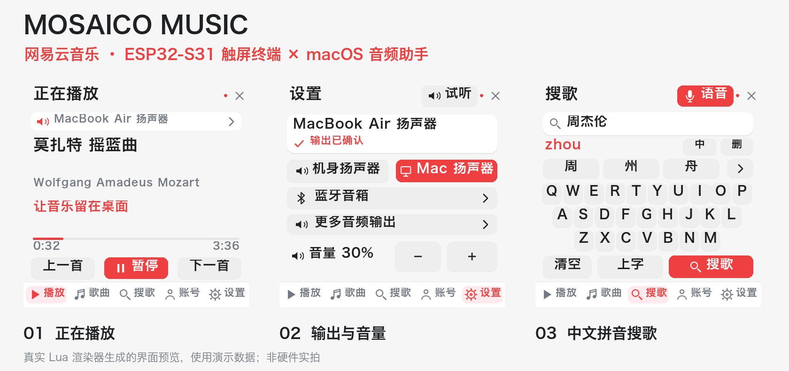
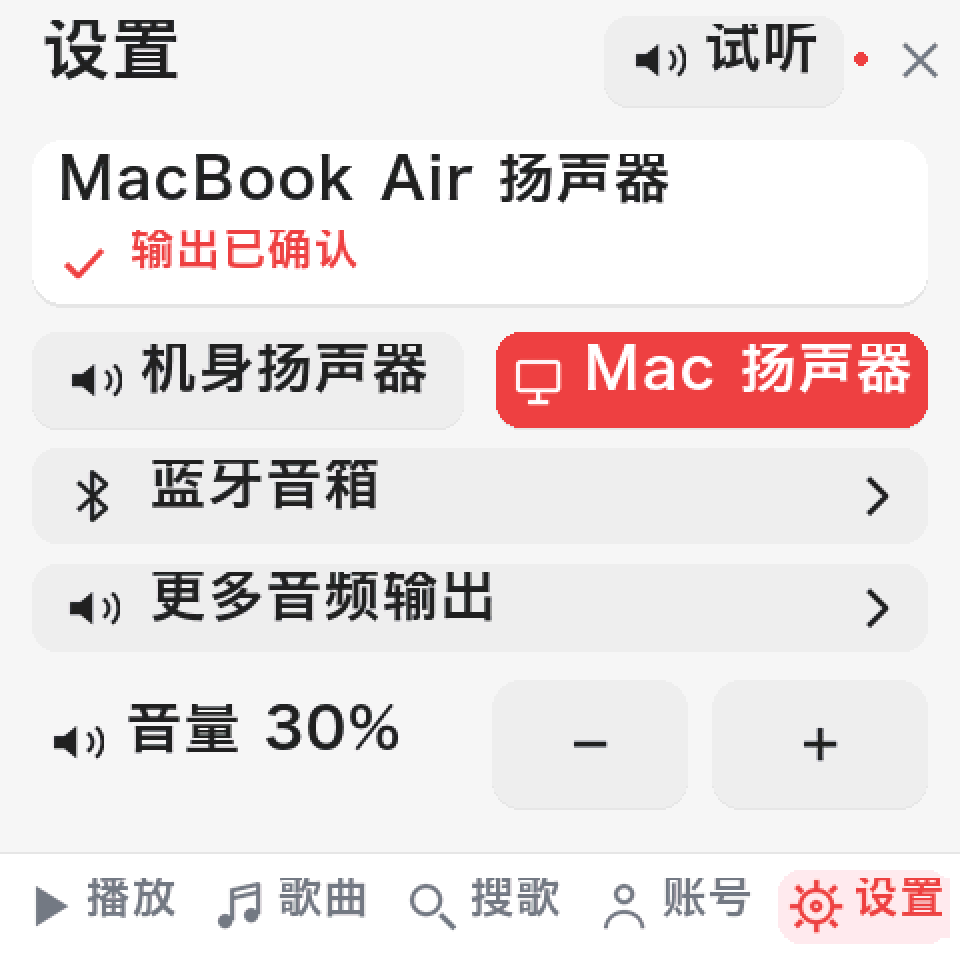
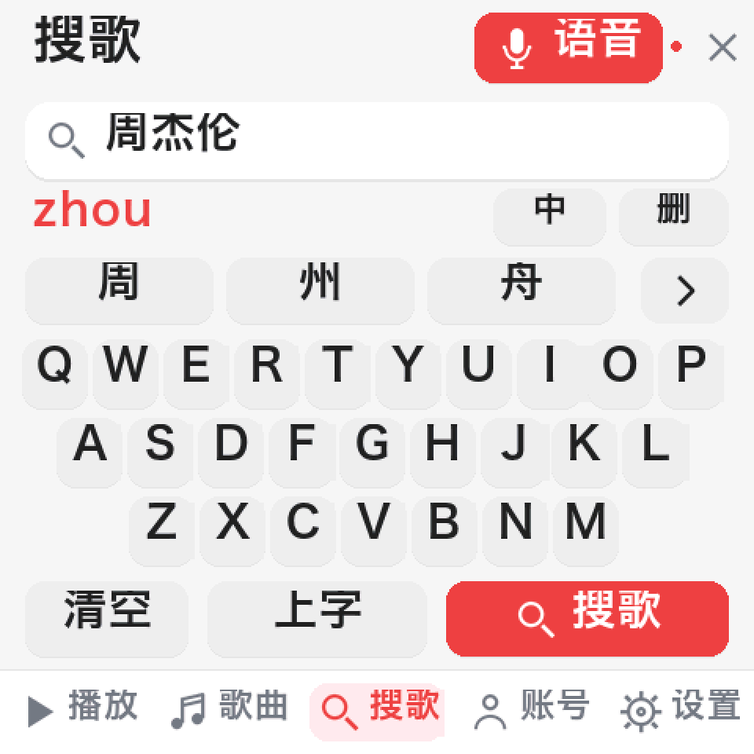
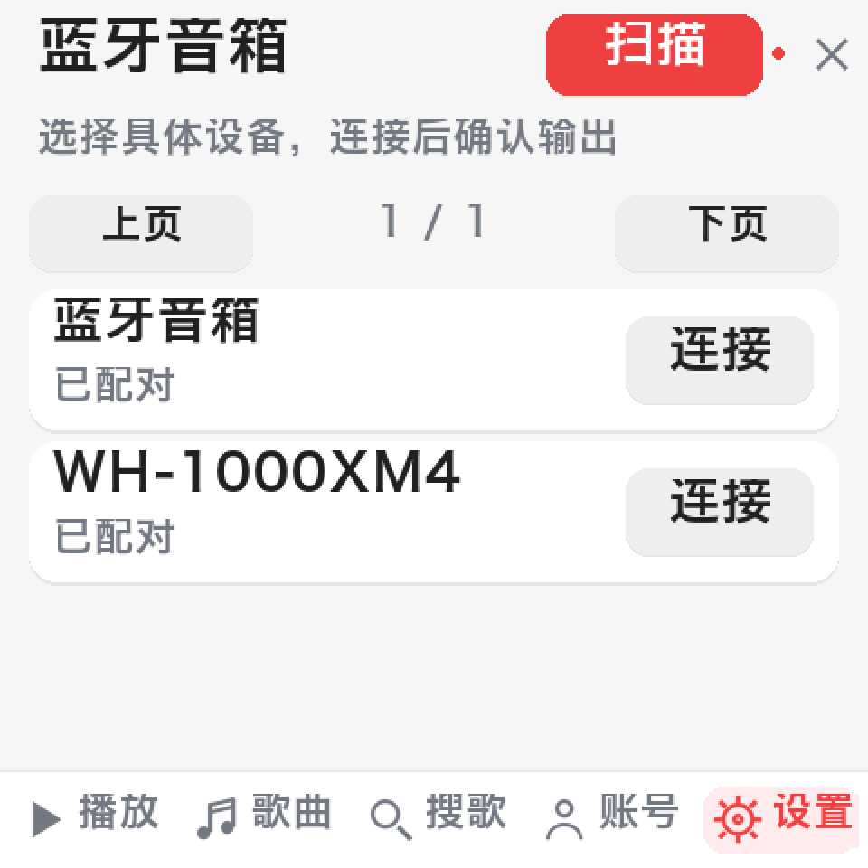

# ESP-Mosaico 网易云音乐 · v0.3



> ESP32-S31 触屏选歌，Mac 精确选择音频设备；支持扫码登录、中文拼音和本地语音搜歌。
> 图中均为真实 Lua 渲染器使用演示数据生成的界面预览，不是硬件实拍。

ESP32-S31 / 480×480 触屏上的网易云音乐应用，配套 Mac 本地服务。2026-11-06 更新：明确选择音频设备、蓝牙音箱入口、中文拼音、语音搜歌；新版增加网易云风格的红白配色、灰阶抗锯齿字体和统一图标。

## 日常使用

1. 在 Mac 双击 **启动音乐.command**，打开 [音乐控制台](http://127.0.0.1:17863)。Mac 服务需保持运行，网页可关闭。
2. ESP32 打开 **Works → Installed → 网易云音乐**。
3. 先到 **设置** 选择输出：机身扬声器、当前 Mac 扬声器，或蓝牙音箱。页面显示具体设备名称和确认状态；点 **试听** 检查声音去向。
4. 音量只在 **设置** 中调整。输出选择与音量会保存，下次启动保留。
5. 到 **搜歌** 输入中文、英文或使用语音；点歌曲开始播放。账号页扫码登录后可打开 **我的歌单**。

设置中会显示当前宿主 Mac 的真实输出名称。Mac 播放使用原生 AVPlayer，按 Core Audio 的设备 UID 指定输出，不接管网易云官方客户端，也不要求浏览器保持打开。切换输出会停止旧播放，之后重新点播放。

## 五个触屏页签

| 页面 | 操作 |
| --- | --- |
| 播放 | 歌名、歌手、歌词、进度、上一首 / 播放暂停 / 下一首；显示声音去向 |
| 歌曲 | 每页 3 首，点上下页继续浏览；歌单最多载入 1000 首 |
| 搜歌 | 拼音候选字、英文键盘、语音输入 |
| 账号 | 网易云 App 扫码登录、个人歌单 |
| 设置 | 具体输出设备、蓝牙扫描连接、试听、音量 |

新版按 **480×480 方屏**重新安排层级：网易云风格红 `#EC4141` 作为主色，搭配白色卡片、中性灰背景和深灰文字。标题 **34 px**、主要文字与键盘 **28 px**、歌手和状态说明 **22 px**，均采用本机生成的冬青黑体 W6。较大的触摸区域、统一的扬声器/蓝牙/麦克风图标、轻微卡片阴影和红色选中状态，方便快速辨认操作。

文字由原先的黑白点阵升级为 **16 级灰阶抗锯齿**。三种字号均覆盖 21,785 个字形，包括基础汉字、日文假名和常见拉丁字符；歌名、歌手和候选字采用相同的字库覆盖。长文本按像素宽度省略或换行。韩文等未收录字形可能显示问号。

字库采用 AFN1 压缩格式，拆为每个不超过 256 KiB 的文件以适配出厂系统上传接口；按需读取单个字形，不把整套汉字资源加载进内存；每个字号最多缓存 256 个着色字形。字体文件约 23.5 MB，首次部署需上传全部资源，后续仅写入发生变化的文件；图标由项目自行绘制。Mac 网页控制台也采用相同红白主题。

## 中文与语音搜歌

**拼音输入**：在“搜歌”页输入 `zhou`，点候选“周”，继续输入 `jie`、`lun` 并选字即可得到“周杰伦”；也加入了一些完整歌手名候选。`中 / EN` 切换中文与英文；“删”按 UTF-8 字符删除；“上字”提交当前首选候选。候选字典从固定版本 `pinyin-pro 3.29.5` 生成，在设备本地运行，不向在线输入法发送按键。

**语音输入**：点“语音”，看到提示后对 ESP32 说歌名或歌手。设备录音 4 秒，经局域网交给当前 Mac；Apple Speech 在 Mac 本机识别中文，再用识别文字搜索网易云。识别完成后清除临时录音。音频不发送给第三方语音服务；搜索文字仍按正常搜歌流程发送给网易云。

首次使用需在 Mac 允许“Mosaico 音乐助手”进行语音识别。助手通过正常 macOS 应用身份启动，授权属于这台 Mac；在 Mac mini 需重新授权。系统需有可用的中文离线识别语言，未就绪时会明确提示。

## 蓝牙与 HomePod

沿用 [大家的日语项目](https://github.com/WUHAO19831214/esp32-minna-no-nihongo-coach) 的 Mac 桥接路线：**Mac 扫描、配对、连接音箱；ESP32 提供选择和控制界面**。没有刷写 ESP32 蓝牙固件；当前 Lua 音频接口没有直接提供 A2DP 音箱选择控制。

“设置 → 蓝牙音箱”可读取已配对设备、扫描附近可发现设备，选择后连接。只有设备连接且 Core Audio 提供对应的真实输出 UID，才确认选择成功；不会随便选列表第一项或用模糊名称代替确认。需要 PIN 或配对码时由本人在 Mac 确认。音箱断开后播放暂停并显示错误，不自动将声音转给另一设备。

本次按用户要求，实物验收的是 **MacBook Air 扬声器**，没有把蓝牙音箱连接标为已验收。

HomePod 主要使用 **AirPlay**，不按普通蓝牙音箱处理。[Apple 的说明](https://support.apple.com/en-gb/105068) 介绍了从 Mac 控制中心选择 AirPlay 输出的方法。“更多音频输出”会列出当前 macOS 实际提供的输出；HomePod 需要以后接入实物再验证。

## MacBook Air 与 Mac mini

设置页显示当前宿主 Mac 名称、实时设备列表和所选设备，不写死 MacBook Air、Mac mini 或某个音箱地址。Mac mini 复刻时重新构建本机助手、完成本机授权并选择其实际设备；不沿用不存在的外设 UID。

需要 ESP-Mosaico / ESP32-S31、480×480 触屏、带 Lua 应用和文件管理接口的 ESP-Claw 出厂系统，以及同一局域网内的 Mac。已验证 Apple Silicon Mac；其他 ESP32 开发板、Windows / Linux 不可直接套用。

首次准备依赖（Node.js 22+、Python 3.10+、macOS Command Line Tools）：

```sh
git clone https://github.com/WUHAO19831214/esp32-mosaico-music.git
cd esp32-mosaico-music
npm ci --ignore-scripts
python3 -m venv .venv
.venv/bin/pip install -r requirements-dev.txt
# 在这台 Mac 本地生成字体；仓库不分发系统字体文件
.venv/bin/python host/build_assets.py
node host/configure.cjs 192.168.1.100  # 换成自己的 ESP32 IP
./启动音乐.command
```

首次启动前先在设备设置里查到 IP，完成以上配置。然后部署：

```sh
.venv/bin/python host/device.py upload
.venv/bin/python host/device.py bootstrap
.venv/bin/python host/device.py publish
.venv/bin/python host/device.py start --page settings
```

`bootstrap` 通过设备原生 Agent 启动已校验脚本，需要设备已有可用模型服务；它不配置或索取模型密钥。槽位不足时请先退出正在运行的前台应用。

启动器在需要时从 `native/MusicHelper.swift` 构建本机应用助手。账号会话、配对配置、音频偏好和权限都属于本机，不通过 GitHub 传递。设备部署工具已独立化，仅使用 Python 标准库；不依赖其他个人项目。两台 Mac 同时控制同一播放器不在本次验收范围内。

## 维护与共存

出厂系统最多同时运行 4 个 Lua 任务。音乐接收与音频共用 1 个，音乐前台再占 1 个；与状态牌两个后台一起达到上限。前台切换需要退出当前界面。没有停止、卸载或更改其他项目的 Mac 后台服务，也没有修改其文件和配对。

设备机身播放的进度为估算值；Mac 播放进度来自原生播放器实际时间。没有提供精确拖动进度功能。账号权限、地区、版权或只有试听片段时会明确报错，不自动换其他来源。

```sh
# 本目录执行
node host/launch.cjs --no-open
node host/launch.cjs stop
/opt/homebrew/bin/python3.12 host/device.py status

# 更新前先关闭本音乐界面；这些命令只操作 music_player
/opt/homebrew/bin/python3.12 host/device.py stop
/opt/homebrew/bin/python3.12 host/device.py upload
/opt/homebrew/bin/python3.12 host/device.py bootstrap
/opt/homebrew/bin/python3.12 host/device.py start --page settings
```

设备地址由 `node host/configure.cjs <设备IP>` 保存在本机配置中。安装会核对已配对设备，备份不同文件并读回验证；GET 文件读取会有限重试，避免局域网传输中断被误认成成功。启动接收服务会检查新实例，不能仅凭旧接口仍在线就声称更新完成。

Mac 服务仅监听 `127.0.0.1:17863`，设备回调使用独立随机配对值。网页写操作要求同源与 CSRF 校验，服务重启后页面会更新令牌重试。账号会话只保存在本机 `.local/session`，权限 600，不传给设备。配置、录音、缓存、日志不纳入版本库。

## 参考与验证

| 来源 | 采用或借鉴的内容 |
| --- | --- |
| [大家的日语](https://github.com/WUHAO19831214/esp32-minna-no-nihongo-coach) | 设置页与 Mac 蓝牙音频桥接路线 |
| [esp32-p4-music-page](https://github.com/exder145/esp32-p4-music-page) | 音乐页面思路；其 P4 横屏 / Windows 代理未原样移植 |
| [LVGL Pinyin IME](https://github.com/lvgl/lvgl/blob/master/docs/src/widgets/ime_pinyin.mdx) | 嵌入式拼音、候选字交互与字库约束 |
| [pinyin-pro](https://github.com/zh-lx/pinyin-pro) | 离线候选字典数据；许可保留于 `third-party/` |
| [whisper.cpp](https://github.com/ggml-org/whisper.cpp) | 调研了离线语音方案；本版实际采用 Apple Speech，不运行 Whisper |
| [AVPlayer 音频输出 UID](https://developer.apple.com/documentation/avfoundation/avplayer/audiooutputdeviceuniqueid) | 将音频绑定到明确的本机输出设备 |
| [NeteaseCloudMusicApiEnhanced](https://github.com/NeteaseCloudMusicApiEnhanced/api-enhanced) | 登录、搜索、歌单与账号有权访问的标准音源 |

已通过：中文拼音候选与 UTF-8 删除、选歌事件 ID 与确认机制、三行分页、输出选择、八页真实 Lua 渲染、HTTP 访问保护；设备应用文件读回一致；明确 UID 的 Mac 原生网络播放与时间推进；本机中文识别测试句；真机人工验收确认 Mac 音频切换、出声以及语音搜索结果正常。

v0.3 已完成八页真机启动与灰阶字形绘制检查，中文搜索返回正常，可完整播放曲目的 Mac 播放时间持续推进，输出 UID 与音量保持不变。当前 ESP-Mosaico 实测字库初始化约 2 秒，首次绘制约 1.1–2.3 秒，缓存后的单次绘制约 0.10–0.20 秒；冷启动与首次出现新文字仍需等待资源读取。原有状态牌后台同步与灯光任务继续运行。

```sh
node --test tests/server.test.cjs
.venv/bin/python tests/check_ui.py
```

设备此前曾发生重启与短时连接中断，原因尚未确定；长期稳定性仍需观察。系统字体仅用于本机生成资源，字体二进制不随仓库发布；部署不执行固件刷写或设备重置。

## 界面细节

以下预览均为 960×960 PNG，按原始 480×480 像素整数放大，避免文字被插值模糊。演示音量与示例设备不代表用户当前设置。

| 输出设置：音量集中管理 | 中文输入：拼音与候选字 |
| --- | --- |
|  |  |

| 蓝牙设备选择 | 大字歌曲列表 |
| --- | --- |
|  |  |

## 源码结构与数据流

```text
app/scripts/       Lua 前台、输入法、接收服务与设备音频
app/assets/        图标；AFN1 灰阶字库由本机生成
host/server.cjs    网易云登录、搜索、歌单、播放队列与同步
host/audio.cjs     Mac 音频与蓝牙助手的进程管理
host/device.py     独立的部署、读回校验、发布与启动工具
native/            Swift：Core Audio / AVPlayer / IOBluetooth / Speech
web/               本机网页控制台
tests/             事件确认、中文输入、布局与 HTTP 保护回归
docs/images/       公开演示配图；不包含账号截图
third-party/       第三方许可说明
```

ESP32 触摸事件 → 本机桥接 → 网易云搜索 / 账号音源 → ESP32 解码，或指定 UID 的 Mac 输出。语音走 ESP32 麦克风 → 局域网临时录音 → Mac 本地识别 → 网易云文字搜索。

## 常见问题

- **设置里能选设备但没有声音**：检查所选名称是否正确并在线，先点试听；再检查设置页音量，切换后重新点歌曲。
- **设备无法连接**：确认两端同一局域网，没有访客网络隔离；重新执行 configure 更新 IP。首次确认的 ESP-Claw 身份会记住，身份变化时不会悄悄连接另一块设备。
- **字库加载失败**：先运行 build_assets.py，再重新上传 `.afn` 字库和 `scripts/font.lua`。公开仓库没有附带系统字库二进制。
- **语音失败**：在当前 Mac 允许音乐助手的语音识别，确认中文离线语言可用；看到录音提示后再说话。
- **普通蓝牙音箱与 HomePod**：前者需要进入配对模式；后者主要走 AirPlay，需单独实物验收。
- **付费曲目不可用**：本项目遵从接口返回的账号播放权限，不提供解锁、破解或第三方换源。

本项目不是网易云或 Apple 官方客户端。音乐资源及账号权限属于相应服务，第三方组件许可见对应上游与 third-party。
